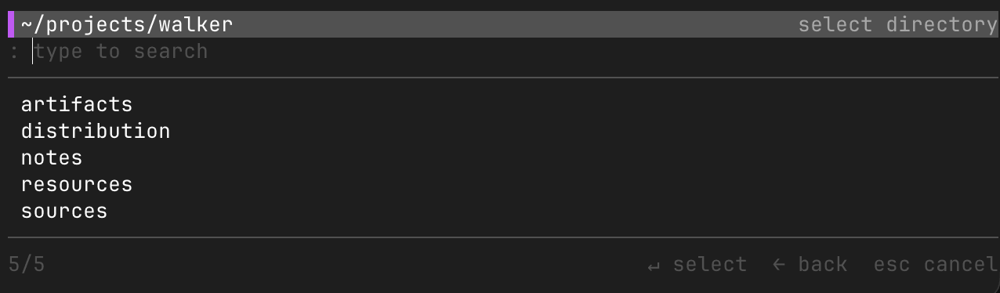

# Walker

[](https://github.com/vstelmakh/walker/actions/workflows/build-and-test.yml)

**Walker** – a terminal directory navigator. Browse your folders, search them as you type and jump to the one you
need. A fast and easy-to-use `cd` and `ls` replacement, shipped as a single small binary.



## Installation

Install the latest release with the installation script. It picks the binary for your OS and architecture, verifies its
checksum and puts it in `/usr/local/bin`:
```bash
curl -fsSL https://raw.githubusercontent.com/vstelmakh/walker/main/install.sh | bash
```

To update, run the same command again. It replaces the installed binary.

<details>
<summary>Specific Version or Directory</summary>

To install a specific version or to use another directory:
```bash
curl -fsSL https://raw.githubusercontent.com/vstelmakh/walker/main/install.sh | INSTALL_DIR=~/.local/bin bash -s -- 1.2.3
```

</details>

<details>
<summary>Manual Installation</summary>

1. Download the binary for your system from the [latest release](https://github.com/vstelmakh/walker/releases/latest).
2. Rename it to `walker`, make it executable and move it to a directory in your `PATH`:
   ```bash
   chmod +x walker
   sudo mv walker /usr/local/bin/walker
   ```

> **Note:** macOS may block a binary downloaded in a browser because it is not signed. Remove the quarantine flag to
> allow it: `xattr -d com.apple.quarantine walker`.

</details>

<details>
<summary>Build from Source</summary>

Build and install it with [Go](https://go.dev/):
```bash
go install github.com/vstelmakh/walker@latest
```

</details>

## Setup

A program can't change the directory of your shell. Walker prints the path, and a small shell function does the `cd`.

Add the function to your shell config.

> [!TIP]
> You can name the function anything you like. It does not need to be `lk`. This is what you need to type in your
> terminal to start the navigator.

### Bash and Zsh

Add to `~/.bashrc` or `~/.zshrc`:
```bash
function lk {
  cd "$(walker "$@")"
}
```

### Fish

Add to `~/.config/fish/config.fish`:
```fish
function lk
  set -l dir (walker $argv); and cd $dir
end
```

### Reload the Shell

Restart the shell for the function to become available.

<details>
<summary>Reload without restarting</summary>

Bash:
```bash
source ~/.bashrc
```

Zsh:
```bash
source ~/.zshrc
```

Fish:
```fish
source ~/.config/fish/config.fish
```

</details>

## Usage

Run `lk` to start in the current directory or pass a directory to start there:
```bash
lk
lk ~/projects
```


The first row is the current directory. Below it are its subdirectories. Move to the one you want and press `Enter`
to open it. When you are in the right place, move back to the first row and press `Enter` to select it. Your shell
changes to the selected directory.

Start typing at any time to filter the list. The search is fuzzy and looks at the names in the current directory, so
`dwn` finds `Downloads`. A lowercase query ignores case, a query with an uppercase letter matches the case exactly. The
best match is selected first.

### Key Bindings

| Key         | Action                                                                                           |
|-------------|--------------------------------------------------------------------------------------------------|
| `Up` `Down` | Move the selection.                                                                              |
| `Right`     | Open the directory under the selection.                                                          |
| `Left`      | Go to the parent directory.                                                                      |
| `Enter`     | Open the directory under the selection. On the first row, select the current directory and exit. |
| `Backspace` | Delete the last search character. With an empty search, go to the first row, then back.          |
| `Esc`       | Clear the search, then move to the first row, then exit without changing directory.              |
| `Ctrl+C`    | Exit without changing directory.                                                                 |
| Any text    | Search. Pasted text is added to the search too.                                                  |

## Configuration

Configure walker with command line options. To apply an option every time, add it to the shell function from
[Setup](#setup).

Bash and Zsh:
```bash
function lk {
  cd "$(walker --show-hidden "$@")"
}
```

Fish:
```fish
function lk
  set -l dir (walker --show-hidden $argv); and cd $dir
end
```

### Options

| Option          | Description                                          |
|-----------------|------------------------------------------------------|
| `--show-hidden` | Show hidden directories, the ones starting with `.`. |

> [!TIP]
> Run `walker --help` to see all available configuration options.

## Uninstall

1. Remove the binary. The installation script puts it in `/usr/local/bin` by default:
   ```bash
   sudo rm /usr/local/bin/walker
   ```
   If you installed it elsewhere, `which walker` shows where it is.
2. Delete the `lk` function from your shell config. These are the lines you added in [Setup](#setup). Then restart the
   shell.

## Credits

[Volodymyr Stelmakh](https://github.com/vstelmakh)  
Licensed under the MIT License. See [LICENSE](./LICENSE) for more information.

Walker is inspired by [antonmedv/walk](https://github.com/antonmedv/walk).
